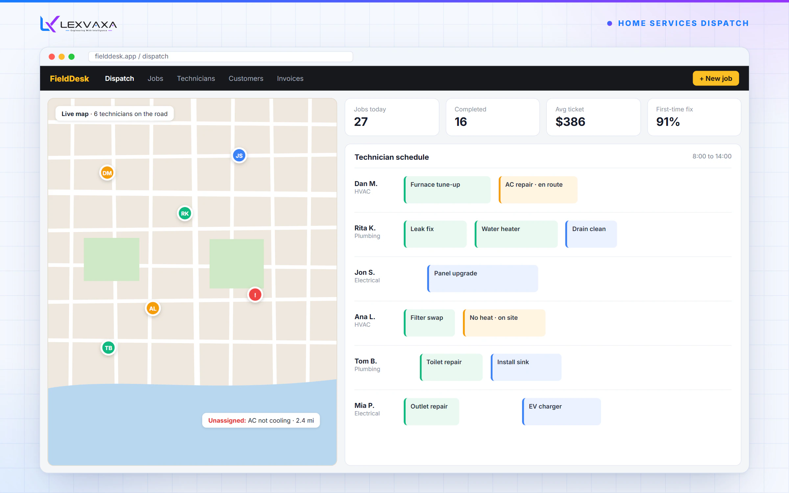

<!-- styled:v2 -->

**A dispatch board for an HVAC and home services team with a live technician map, the daily schedule and unassigned jobs in one view.**

  
  
  
  
  
  
  
  

  <a href="#overview">Overview</a> ·
  <a href="#key-features">Key features</a> ·
  <a href="#results">Results</a> ·
  <a href="#tech-stack">Tech stack</a>

---

## Overview

Dispatchers and owners were tracking jobs and technician performance in spreadsheets and phone calls. Lexvaxa built FieldDesk, a custom dashboard for an HVAC and home services company. It shows a live map of technicians on the road, each technician's schedule for the day, unassigned jobs, and the numbers that matter: jobs booked and completed, average ticket and first-time fix rate, plus jobs per week, by technician and by job type. Screens shown use sample data, so no client records are exposed.

## The challenge

Jobs, routes and technician performance were managed by phone and spreadsheet, so the office had no clear picture of the day.

## The solution

A React dispatch board connected to the field service system and Maps API, with a live map, schedule lanes and performance metrics.

## Key features

- Live map of technicians on the road
- Technician schedule lanes with job status
- Unassigned job alerts with distance
- Jobs booked, completed and average ticket
- First-time fix rate
- Jobs per week, by technician and by job type

## Results

- Dispatch, jobs and technician performance visible in one place

## Tech stack

     

## Demo

A working version of the dashboard UI with **sample data** is in [`demo/index.html`](demo/index.html). Download it and open it in a browser; it has no build step.

## Privacy

Client names and records are confidential. Every screen in this repository uses sample data, and source code that belongs to the client is not published.

## Links

- Case study on Lexvaxa: https://lexvaxa.com/work/field-service-dispatch-board

---

**Built by [Ch Muhammad Samiullah](https://github.com/samiullah156-creator)** · AI Automation Engineer and Full-Stack Developer at [Lexvaxa](https://lexvaxa.com)

⭐ Star this repo if you found it useful

